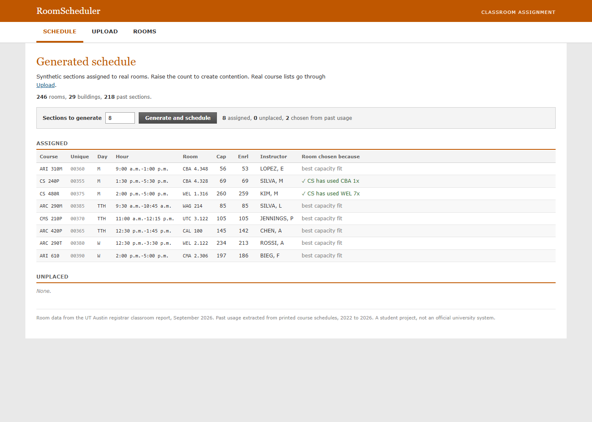

# RoomScheduler

A C# app that assigns university classes to classrooms and flags the ones it cannot
place. It includes 246 general purpose classrooms from the UT Austin
registrar report for September 2026. The courses are generated, but I copied the
meeting patterns and time formats from real printed course schedules.

It runs two ways, as a console app and as a Blazor Server web app, both on the same
scheduling library.



## How the scheduling works

Courses are sorted by enrollment, biggest first, because large classes have the
fewest rooms that can hold them. Each course then takes the best available room,
scored two ways. Every wasted seat costs a point, so a class normally lands in the
smallest room that fits. A building the department has taught in before earns a
bonus, capped so a small class never gets pushed into a lecture hall just to stay in
a familiar building.

A room is unavailable if something already booked there shares a meeting day and
overlaps in time. An MWF section holds its room on all three days. Anything that
cannot be placed goes on an unplaced list rather than crashing, and the app says why
it picked each room.

## Running it

```
dotnet run --project src/RoomScheduler.Web
```

Then open the address it prints, usually http://localhost:5187.

```
dotnet run --project src/RoomScheduler.Cli 50
```

The console version takes an optional number for how many sections to generate.
`dotnet build` builds everything.

## The data

| Source | What it gives |
|---|---|
| Registrar classroom report, September 2026 | 246 rooms in 29 buildings, with capacities |
| Printed course schedules, 2022 to 2026 | 218 past sections across 7 departments |

The past sections came out of 18 scanned catalog pages. They are used to learn which
buildings each department actually teaches in.

## What I learned

**Check the data before trusting it.** The registrar file lists SZB 1.510 twice. I
loaded it as is, so the app treated one room as two and booked it twice at the same
time. I only caught it because I wrote a script that reads the output back and looks
for overlaps.

**One day per class is not how school works.** Classes meet MWF or TTH, and an MWF
class ties up its room three days a week. My first version used a single day and made
buildings look much emptier than they are.

**The old schedules are photos, not text.** I had to OCR them first, and even then the words come out as scattered fragments with coordinates instead of lines. I had to
rebuild each row from the PDF text positions before I could parse it.

**I picked the wrong signal first.** I assumed I could match a class to the exact room it used before. Departments mostly teach in their own buildings, and those rooms are
not general purpose classrooms, so only 19 of the rooms in my history can even be
scheduled. Matching on the building works because there is far more of it and OCR
mistakes matter less.

**Same algorithms don't always work.** Turning the building preference on pushed unplaced
courses from 77 to 90 out of 600, because everything crowds into the same few
buildings. I kept it because the picks look more realistic.

## Limitations

The courses are made up. The patterns are real, but the classes are not.

There's much more class history that's not included in here. There are 218 sections over seven departments, and architecture is about
half of it. The other five pages are one semester each, so there is no repeat pattern
in them.

The preference only works for four of the seven departments. Architecture and
communication teach in buildings my room list does not include.

OCR still gets things wrong. About 2 records in 223 have unreadable times. I flag
those instead of dropping them so I can check them later.

Nothing saves between runs. The scheduler also redoes everything from scratch, so it
cannot add one course to a schedule that already exists.

## What I want to add

Add the departmental classrooms to the room list. Doubles the rooms and would make
the history work for all seven departments instead of four.

Let professors request a room. Needs a database, a pending and approved status, and a
scheduler that can place one course without redoing the rest. This is the big missing
piece.

Use more than the building. The professor level pattern is already in my data. Dudley
T shows up in 10 of the 13 architecture terms.

Pull more schedule pages to cover more departments.

## Layout

```
src/RoomScheduler.Core   the scheduling logic, no UI, used by both apps
  Room.cs                loads rooms, removes duplicate entries
  Course.cs              a section, its meeting days and time formats
  Scheduler.cs           assignment, conflict detection, course generation
  CourseHistory.cs       past building usage per department
  CourseCsv.cs           reads an uploaded course list, loose column matching
  Csv.cs                 shared CSV line parser
  DataFile.cs            finds data files from either working directory

src/RoomScheduler.Cli    console version
src/RoomScheduler.Web    Blazor Server front end
  Schedule page          generate sections and see why each room was picked
  Upload page            drop in a course CSV and schedule it
  Rooms page             browse rooms and which departments have used them

data/                    extracted course history
tools/                   PDF extraction and schedule page collection scripts
class schedule resources/   the original scanned catalog and room report PDFs
```

A student project. Not an official university system.
